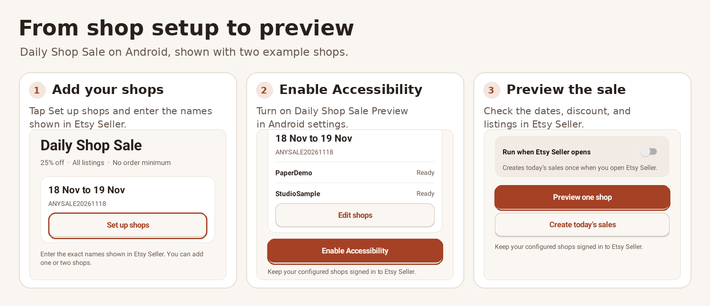

# Daily Shop Sale

**Plan one-day promotions for Etsy shops.** The Android prototype prepares a sale for one or two shops and lets the seller review the inputs before submitting.

[**Try the offline planner**](#try-the-offline-planner) · [Android prototype notes](docs/prototype.md)

[](docs/images/quick-start.png)

*The illustrated Android prototype shows fictional shops. The public example runs locally in Java. The Android download is pending Etsy authorization and live-device testing.*

## Features

- **Sale dates and naming.** Generate a start date, next-day end date and date-based sale name from a supplied local date.
- **Shop presets.** The Android prototype prepares 25% off all listings with no order minimum for one or two shops.
- **Review before submitting.** In simulated testing, the preview stopped at listing selection, before the confirmation step.

## Try the offline planner

With JDK 17 or later, run this from the repository root.

```sh
java examples/SalePlanPreview.java 2026-11-18
```

The output shows the sample offer for November 18–19 and the sale name `ANYSALE20261118`. The sample accepts an ISO date and has no network or Android dependencies.

[View the Java source](examples/SalePlanPreview.java) · [See prototype and testing details](docs/prototype.md)
